<div align="center">

# Neorgon Apps

Neorgon's apps for iPhone and Android, with their help and privacy pages

[![Live][badge-site]][url-site]
[![HTML5][badge-html]][url-html]
[![CSS3][badge-css]][url-css]
[![JavaScript][badge-js]][url-js]
[![Claude Code][badge-claude]][url-claude]
[![License][badge-license]](LICENSE)

[badge-site]:    https://img.shields.io/badge/live_site-0063e5?style=for-the-badge&logo=googlechrome&logoColor=white
[badge-html]:    https://img.shields.io/badge/HTML5-E34F26?style=for-the-badge&logo=html5&logoColor=white
[badge-css]:     https://img.shields.io/badge/CSS3-1572B6?style=for-the-badge&logo=css3&logoColor=white
[badge-js]:      https://img.shields.io/badge/JavaScript-F7DF1E?style=for-the-badge&logo=javascript&logoColor=black
[badge-claude]:  https://img.shields.io/badge/Claude_Code-CC785C?style=for-the-badge&logo=anthropic&logoColor=white
[badge-license]: https://img.shields.io/badge/license-MIT-404040?style=for-the-badge

[url-site]:   https://apps.neorgon.com/
[url-html]:   #
[url-css]:    #
[url-js]:     #
[url-claude]: https://claude.ai/code

</div>

---

## Overview

The catalog of the apps Neorgon makes: Pittari, Naninani and Enerbot Doll on the
App Store, and Kurukuru, HeadPain, Amigos de Enerbot and Celular Listo coming
soon. Each app gets a band in its own hue with its icon, its promise, its
category, a way to get it (the App Store, its web version, or a note to be
told when it ships) and its screenshots, plus links to its help and privacy
policy. An app with a site of its own keeps those pages there (Naninani on
yomu.neorgon.com, Kurukuru on hobbyorbit.neorgon.com); the others keep them
here, at `/<app>/` and `/<app>/privacy/`, the URLs their store records list.

Everything the catalog says about an app comes from one file, `data/apps.json`,
and the page shows public status only. Builds, reviews and release dates live
in each app's own repo.

**Live:** apps.neorgon.com

---

## Features

- **One band per app** -- icon, promise, category, platform and traits, one action, help and privacy links, and a stage of screenshots that scrolls sideways
- **Built from data** -- `tools/build-catalog.py` writes the catalog, its JSON-LD, the 404 page's app list, `css/apps.css`, `llms.txt` and `sitemap.xml` from `data/apps.json`; `--check` fails when a committed output differs
- **Help and privacy pages** -- `/pittari/`, `/headpain/`, `/enerbot-doll/`, `/celular-listo/` (English under `en/`) and `/amigos/`, each with `privacy/`, in the app's language, with a crumb back to the catalog and the family shelf at the foot
- **No script on the app pages** -- the kits' header and footer styles with static markup and a CSP that allows only this site and the CDN stylesheet, so a policy page sends nothing anywhere
- **Drafts stay the app's** -- `tools/import-pages.py` wraps an app session's drafted pages in this site's shell without touching their words

---

## Running locally

A static site with no build step:

```bash
make serve
```

Or manually:

```bash
python3 -m http.server 8904
```

---

## Keeping it true

Edit `data/apps.json`, then run `python3 tools/build-catalog.py` and commit what
it wrote. `python3 tools/build-catalog.py --check` exits 1 when anything is out
of date. Release operations (a build, a submission, a review) are not this
site's business: they live in the app repos' release docs.

| What changed | What to do |
|---|---|
| An app shipped, or a public test opened | its `status` in `data/apps.json` (`available` needs its `store` link; `test` shows Prueba abierta), then build |
| The newest store release | move `featured` to it; one band at a time is featured |
| A promise, a category, a trait or a screenshot | its entry in `data/apps.json`; every screenshot needs alt text and a short feature caption, or the tool refuses |
| New screenshots | resize to 480 px wide WebP into `assets/shots/<app>/` and list them in `data/apps.json` |
| An icon changed | render the app's `AppIcon.icon` with Icon Composer's `ictool` (see `packages/app-icons`) into `assets/icons/`, PNG and WebP |
| A category icon | copy it from `packages/neorgon-ui/fleet/icons/<id>.svg` into `assets/categories/`; without one the chip shows its label alone |
| Pittari, Enerbot Doll or Celular Listo revised their pages | `python3 tools/import-pages.py pittari ../qrpass-ios/docs/app-store/1.0/pages` (or `enerbot-doll ../robodoll-ios/docs/app-store/1.0.0/pages`, or `celular-listo ../phonecheck-android/docs/play-store/pages`); a draft's words are kept, the shell around them is this site's |
| The page shell changed (`import-pages.py`, `doc.css`, `family.css`) | `python3 tools/import-pages.py --rewrap all`, which takes each page's words from the page itself; `--rewrap all --check` exits 1 when a page is out of date |
| Amigos de Enerbot's pages | frozen while its first version is in App Review: both tools refuse to write `amigos/`, and `build-catalog.py --check` fails when either page differs from the copy App Review read (`FROZEN_SHA256`). Import its drafts once the review is over, and drop the hashes then |
| HeadPain's data handling changed | `headpain/privacy/index.html` is this site's own, written by hand from `projects/headpain-ios`; `--rewrap` changes only its shell. The face scan needs a new version of the policy before it ships |
| The share image | `python3 tools/build-catalog.py` rewrites `tools/og-card.html` from the data; serve the site, open it at 1200x630 in a headless browser and save the screenshot as `og-preview.jpg` (JPEG); `og:image:alt` is written from the same data |
| A field `data/apps.json` does not know | add it to `APP_KEYS` in `tools/appdata.py`, or the tool refuses it; release fields (build, review, version, beta, dates) are refused outright, and so are review, beta and relative-age words in any name, promise, trait, caption or alt text |
| The crumb and shelf on Kurukuru's pages | `python3 tools/build-catalog.py --stamp-family` writes them into `../hobbyorbit-site/kurukuru/`, with copies of the icons and `css/family.css` (that site allows only its own images); `--stamp-family --check` reports drift |

Amigos has no screenshots in the catalog until the store set, or a demo
community, is shot.

---

## Architecture



```
apps-site/
├── index.html              # The catalog, in Spanish (the shelf and bands are generated)
├── 404.html                # Self-contained; its app list is generated
├── data/apps.json          # Every app fact the catalog shows: public status only
├── amigos/                 # Amigos de Enerbot help + privacy/ (Spanish; frozen during review)
├── pittari/                # Pittari support + privacy/ (English)
├── headpain/               # HeadPain support + privacy/ (English, written here by hand)
├── enerbot-doll/           # Enerbot Doll help + privacy/ (Spanish)
├── celular-listo/          # Celular Listo (Android) help + privacy/ (Spanish; English under en/)
├── css/
│   ├── style.css           # Fleet baseline and the site accent
│   ├── catalog.css         # The shelf, the bands and the screenshot stage
│   ├── apps.css            # Each app's hue and ink (generated)
│   ├── doc.css             # The help and privacy pages
│   ├── family.css          # The crumb and the family shelf (also copied to hobbyorbit-site)
│   └── neorgon-*.css       # Vendored kits (header, themes, footer, beacon)
├── js/neorgon-*.js         # Vendored kits, catalog page only
├── assets/
│   ├── icons/              # App icons rendered from each AppIcon.icon
│   ├── categories/         # Category icons from packages/neorgon-ui/fleet/icons
│   └── shots/<app>/        # Screenshots, 480 px WebP
├── tools/
│   ├── build-catalog.py    # Writes the catalog and its siblings from data/apps.json
│   ├── import-pages.py     # Wraps an app's drafted pages in this site's shell
│   └── appdata.py          # The data, checked, and the pieces both tools share
├── docs/architecture.mmd   # Source of the diagram above
├── llms.txt, sitemap.xml   # Generated
├── robots.txt, CNAME
└── favicon set             # Generated from the hub card by sync-favicon.sh
```

---

<div align="center">
<sub>Part of <a href="https://neorgon.com/">Neorgon</a></sub>
</div>
