<div align="center">

# Neorgon Apps

Neorgon's iPhone apps, with their help and privacy pages

[![Live][badge-site]][url-site]
[![HTML5][badge-html]][url-html]
[![CSS3][badge-css]][url-css]
[![JavaScript][badge-js]][url-js]
[![Claude Code][badge-claude]][url-claude]
[![License][badge-license]](LICENSE)

[badge-site]:    https://img.shields.io/badge/live_site-0063e5?style=for-the-badge&logo=googlechrome&logoColor=white
[badge-html]:    https://img.shields.io/badge/HTML5-E34F26?style=for-the-badge&logo=html5&logoColor=white
[badge-css]:     https://img.shields.io/badge/CSS3-1572B6?style=for-the-badge&logo=css3&logoColor=white
[badge-js]:      https://img.shields.io/badge/JavaScript-F7DF1E?style=for-the-badge&logo=javascript&logoColor=black
[badge-claude]:  https://img.shields.io/badge/Claude_Code-CC785C?style=for-the-badge&logo=anthropic&logoColor=white
[badge-license]: https://img.shields.io/badge/license-MIT-404040?style=for-the-badge

[url-site]:   https://apps.neorgon.com/
[url-html]:   #
[url-css]:    #
[url-js]:     #
[url-claude]: https://claude.ai/code

</div>

---

## Overview

The catalog of the iPhone apps Neorgon makes: Naninani, Amigos de Enerbot,
Pittari, Kurukuru, HeadPain and Enerbot Doll. Each card shows the app's icon, where it
really stands (App Store or TestFlight, read from the app's own release docs),
screenshots taken from the app and links to its help and privacy policy. An
app with a site of its own keeps its pages there; the others keep them here, at
`/<app>/` and `/<app>/privacy/`, the URLs their App Store Connect records list.

**Live:** apps.neorgon.com

---

## Features

- **One card per app** -- icon, one line, real state, up to five screenshots in a strip that scrolls, and its links
- **Help and privacy pages** -- `/amigos/`, `/pittari/`, `/headpain/` and `/enerbot-doll/`, each with `privacy/`, in the app's language
- **No script on the app pages** -- the kits' header and footer styles with static markup and a CSP that allows only this site and the CDN stylesheet, so a policy page sends nothing anywhere
- **Drafts stay the app's** -- `tools/import-pages.py` wraps an app session's drafted pages in this site's shell without touching their words

---

## Running locally

A static site with no build step:

```bash
make serve
```

Or manually:

```bash
python3 -m http.server 8904
```

---

## Keeping it true

| What changed | Where to edit |
|---|---|
| An app's state (a new build, a submission, a release) | its `<article>` in `index.html`, the `app__state` line |
| Amigos, Pittari or Enerbot Doll revised their pages | `python3 tools/import-pages.py amigos ../amigos-ios/docs/app-store/1.0.0/pages` (or `pittari ../qrpass-ios/docs/app-store/1.0/pages`, or `enerbot-doll ../robodoll-ios/docs/app-store/1.0.0/pages`) |
| An app's pages in more than one language | its `langs` in `tools/import-pages.py`, the App Store record's primary language first; each other language's drafts go in `<pages>/<lang>/` and land at `/<app>/<lang>/` |
| HeadPain's data handling changed | `headpain/privacy/index.html` is this site's own, written from `projects/headpain-ios` at build 5. The face scan on its `face-scan` branch needs a new version before it ships |
| New screenshots | resize to 480 px wide WebP into `assets/shots/<app>/`, keep the alt text true |
| An icon changed | render the app's `AppIcon.icon` with Icon Composer's `ictool` (see `packages/app-icons`) into `assets/icons/` |

Amigos' cards use simulator captures from `docs/screenshots/` in amigos-ios;
replace them with the 6.9-inch store set once it is committed under
`docs/app-store/1.0.0/screenshots/iphone-6.9/`.

---

## Architecture



```
apps-site/
├── index.html              # The catalog, in Spanish
├── amigos/                 # Amigos de Enerbot help + privacy/ (Spanish)
├── pittari/                # Pittari support + privacy/ (English)
├── headpain/               # HeadPain support + privacy/ (English)
├── enerbot-doll/           # Enerbot Doll help + privacy/ (Spanish)
├── css/
│   ├── style.css           # Fleet baseline and the site accent
│   ├── catalog.css         # The catalog's cards and screenshot strips
│   ├── doc.css             # The help and privacy pages
│   └── neorgon-*.css       # Vendored kits (header, themes, footer, beacon)
├── js/neorgon-*.js         # Vendored kits, catalog page only
├── assets/
│   ├── icons/              # App icons rendered from each AppIcon.icon
│   └── shots/<app>/        # Simulator screenshots, 480 px WebP
├── tools/import-pages.py   # Wraps an app's drafted pages in this site's shell
├── docs/architecture.mmd   # Source of the diagram above
├── robots.txt, sitemap.xml, 404.html, CNAME
└── favicon set             # Generated from the hub card by sync-favicon.sh
```

---

<div align="center">
<sub>Part of <a href="https://neorgon.com/">Neorgon</a></sub>
</div>
